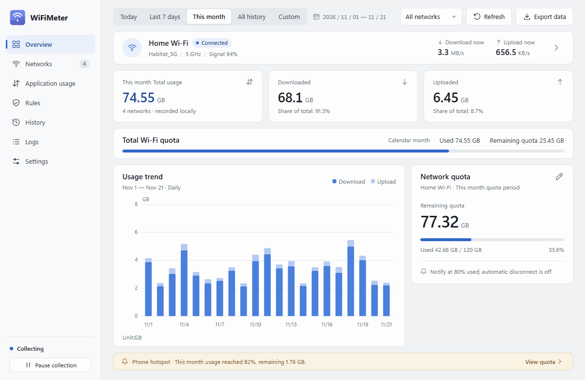
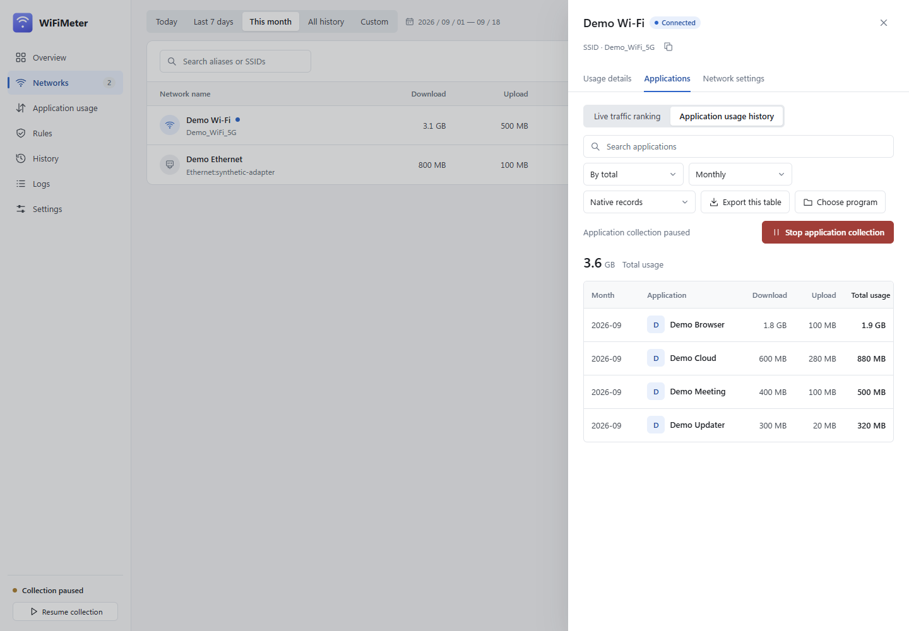

<p align="center">
  
</p>

<h1 align="center">WiFiMeter</h1>

<p align="center">
  <a href="README.md">简体中文</a> · <strong>English</strong>
</p>

<p align="center">
  Check live network speeds and see which applications use your connection.<br />
  Track daily usage by network, with data stored on your computer.
</p>

<p align="center">
  <a href="docs/releases/v1.3.7.md#english"></a>
  <a href="docs/PACKAGING-MATRIX.md"></a>
  <a href="docs/ARCHITECTURE.md"></a>
  <a href="docs/ARCHITECTURE.md"></a>
  <a href="docs/MIGRATION.md"></a>
  <a href="LICENSE"></a>
</p>

<p align="center">
  <strong><a href="https://github.com/chronicle12345/WiFiMeter/releases/latest">Download for Windows</a></strong>
  &nbsp; · &nbsp; <a href="docs/README.en.md">Documentation</a>
  &nbsp; · &nbsp; <a href="CHANGELOG.md">Changelog</a>
</p>



<p align="center"><sub>Recorded from the current interface · All networks, application records and traffic are simulated</sub></p>

## What it does

- Track home, studio and phone hotspot usage separately, and check live speeds on Wi-Fi and Ethernet.
- Rank applications by traffic, search for a program, and review history by minute, hour, day or month, including custom ranges.
- Set daily, monthly or cumulative quotas for one network or all Wi-Fi connections. Get warnings near the limit, with optional Wi-Fi disconnection when exceeded.
- Check speeds and recent application usage in the Windows floating window. Pin it, change its shape or hide it at the screen edge.
- Block network access per Windows application, set separate upload and download limits, and manage saved rules.
- Export CSV/JSON, save complete backups, or use WebDAV for automatic backups and restoration on another device.

The application supports light and dark themes, English and Chinese, tray mode, and login startup. On Windows, you can also view labeled estimates of application traffic through a proxy.

<details>
<summary>View overview and application history screenshots</summary>




</details>

## Install and update

Download the Windows x64 installer from [Releases](https://github.com/chronicle12345/WiFiMeter/releases/latest) and follow the setup prompts. On first launch, enable application traffic capture if needed and complete authorization. Settings contains floating window, backup and login startup options. The installer installs WebView2 if it is missing.

Windows x64 can check for updates in the application; download and installation each ask for confirmation. Exit WiFiMeter normally before a manual upgrade.

<details>
<summary>Other platforms, older versions and usage notes</summary>

Version 1.3.7 provides a Windows x64 installer. Builds for Linux and other Windows architectures are paused; [source build instructions](packaging/README.md) and older releases remain available.

Electron 1.2.x users need to install the Tauri version once; existing SQLite data is preserved. Earlier file-based Windows versions can import their old directory in Settings. See [data migration and recovery](docs/MIGRATION.md) for backups and older profiles.

The combined Wi-Fi quota counts Wi-Fi only. Proxy estimates leave network totals and quota counters unchanged. Download limits apply while WiFiMeter is running; for applications using a proxy, set limits on the proxy program.

</details>

## Run from source

Install Node.js, Rust, CMake, a C++20 compiler, and the [Tauri platform prerequisites](https://v2.tauri.app/start/prerequisites/), then run:

```sh
git clone https://github.com/chronicle12345/WiFiMeter.git
cd WiFiMeter
git switch dev
npm ci --prefix apps/desktop
npm run build:backend
npm start
```

Use `npm run test:unit` and `npm run test:ui` for desktop checks. The [testing guide](docs/TESTING.md) covers backend and native-host checks. Read the [development workflow](docs/DEVELOPMENT.md) before contributing.

## Documentation and feedback

The [documentation index](docs/README.en.md) links to floating-window, application-capture, recovery, and development guides. [Open an issue](https://github.com/chronicle12345/WiFiMeter/issues) to report a problem or suggest a feature.

## License

WiFiMeter uses the [MIT license](LICENSE). Dependency licenses are listed in [third-party notices](backend/third_party/README.md) and [WinDivert notices](apps/desktop/native/windows/WinDivert/README.md).
