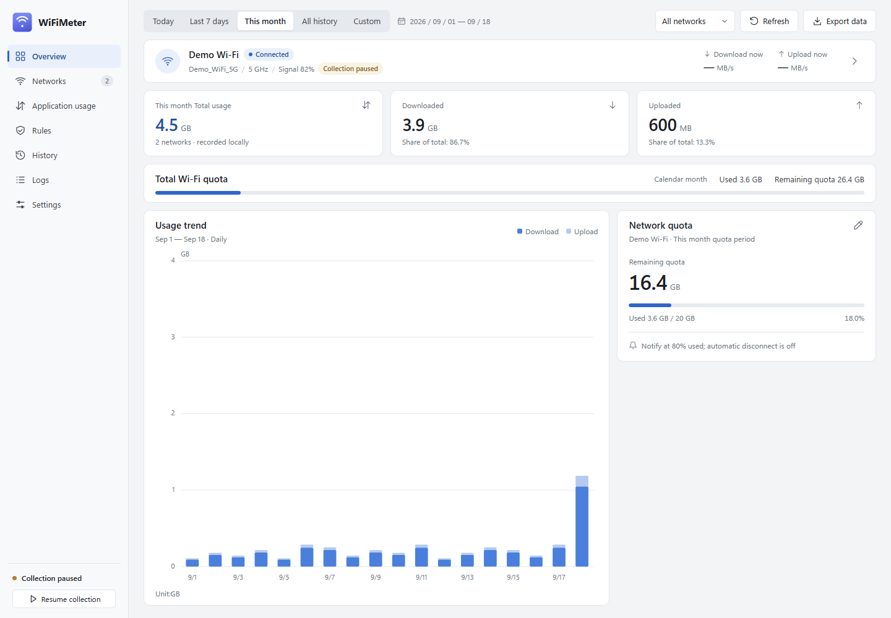

<p align="center">
  
</p>

# WiFiMeter

<p align="center">
  <a href="docs/releases/v1.3.7.md#english"></a>
  <a href="docs/PACKAGING-MATRIX.md"></a>
  <a href="docs/ARCHITECTURE.md"></a>
  <a href="docs/ARCHITECTURE.md"></a>
  <a href="docs/MIGRATION.md"></a>
  <a href="LICENSE"></a>
</p>

[简体中文](README.md) | English

WiFiMeter is a desktop traffic monitor for checking network speeds, finding which applications use your connection, and tracking daily usage by network. It stores your data locally.

[Download for Windows](https://github.com/chronicle12345/WiFiMeter/releases/latest) · [Documentation](docs/README.en.md) · [Changelog](CHANGELOG.md)


The demo uses the current interface with synthetic networks, application records, and traffic.

## What it does

- Show live speeds and upload/download usage for Wi-Fi and Ethernet. Keep separate records for each network and add your own network labels.
- Rank applications by traffic, search for an application, and review usage by minute, hour, day, or month, including custom date and time ranges. On Windows, you can also view estimates of application traffic through a proxy; estimates are labeled.
- Set quotas for one network or all Wi-Fi connections, with daily, monthly, or cumulative periods. Get warnings before a quota runs out, or disconnect Wi-Fi automatically when it is exceeded.
- Keep speeds and recent application usage visible in the Windows floating window. Pin its position, change its shape, or hide it at the screen edge.
- Block a Windows application's network access or limit its upload and download speeds separately. Review and edit saved restrictions on the Rules page.
- Export CSV/JSON, save complete backups, or use WebDAV for automatic backups and restoration on another device.

The interface supports English and Chinese, tray mode, and login startup. Proxy estimates leave network totals and quota counters unchanged; the combined Wi-Fi quota counts Wi-Fi only. Download limits apply while WiFiMeter is running. For applications using a proxy, set limits on the proxy program.

<details>
<summary>View screenshots</summary>




</details>

## Install and update

Download the installer from [Releases](https://github.com/chronicle12345/WiFiMeter/releases/latest) and follow the setup prompts. Version 1.3.7 provides a Windows x64 installer. Builds for Linux and other Windows architectures are paused; [source build instructions](packaging/README.md) and older releases remain available.

On first launch, enable application traffic capture if needed and follow the authorization prompt. Settings contains the floating window, backup, and login startup options. The installer installs WebView2 if it is missing.

Windows x64 can check for updates in the application; download and installation each ask for confirmation. Exit WiFiMeter normally before a manual upgrade. Electron 1.2.x users need to install the Tauri version once; existing SQLite data is preserved. Earlier file-based Windows versions can import their old directory in Settings. See [data migration and recovery](docs/MIGRATION.md) for backups and older profiles.

## Run from source

Install Node.js, Rust, CMake, a C++20 compiler, and the [Tauri platform prerequisites](https://v2.tauri.app/start/prerequisites/), then run:

```sh
git clone https://github.com/chronicle12345/WiFiMeter.git
cd WiFiMeter
git switch dev
npm ci --prefix apps/desktop
npm run build:backend
npm start
```

Use `npm run test:unit` and `npm run test:ui` for desktop checks. The [testing guide](docs/TESTING.md) covers backend and native-host checks. Read the [development workflow](docs/DEVELOPMENT.md) before contributing.

## Documentation and feedback

The [documentation index](docs/README.en.md) links to floating-window, application-capture, recovery, and development guides. [Open an issue](https://github.com/chronicle12345/WiFiMeter/issues) to report a problem or suggest a feature.

## License

WiFiMeter uses the [MIT license](LICENSE). Dependency licenses are listed in [third-party notices](backend/third_party/README.md) and [WinDivert notices](apps/desktop/native/windows/WinDivert/README.md).
