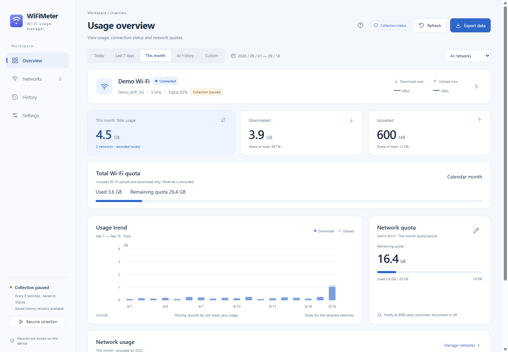
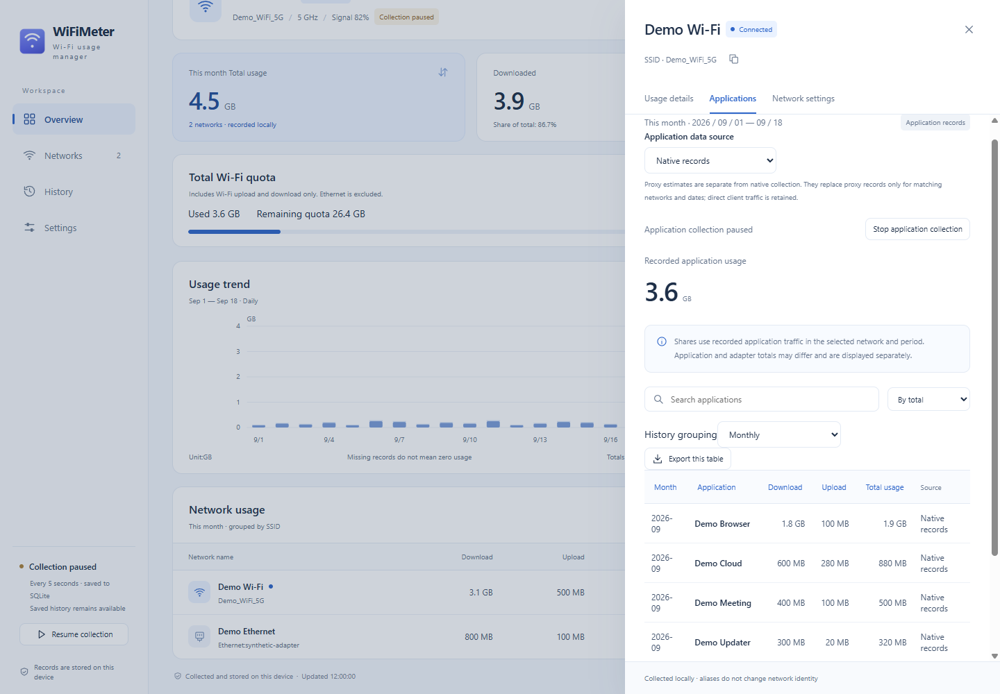

<p align="center">
  <a href="docs/assets/logo.svg"></a>
</p>

<p align="center">
  <a href="docs/releases/v1.3.6.md"></a>
  <a href="docs/PACKAGING-MATRIX.md"></a>
  <a href="docs/ARCHITECTURE.md#c-backend"></a>
  <a href="LICENSE"></a>
</p>

<p align="center">
  <a href="docs/ARCHITECTURE.md#current-data-flow"></a>
  <a href="docs/MIGRATION.md"></a>
  <a href="README.zh-CN.md"></a>
</p>

<p align="center">
  <a href="#build-and-test">Build and test</a> &nbsp;·&nbsp;
  <a href="docs/MIGRATION.md">Migration guide</a> &nbsp;·&nbsp;
  <a href="docs/PACKAGING-MATRIX.md">Platforms and packages</a> &nbsp;·&nbsp;
  <a href="https://github.com/chronicle12345/WiFiMeter/releases">Releases</a>
</p>

<p align="center"><strong>English</strong> &nbsp;|&nbsp; <a href="README.zh-CN.md">简体中文</a></p>

A desktop network usage meter with shared source code for Windows and Linux. Tauri renders the interface using the system WebView; a native C++ backend samples traffic and stores history in SQLite. Data stays on the computer. Version 1.3.6 builds and publishes only the Windows x64 installer. Windows x86/ARM64 and Linux x64/ARM64 CI builds are temporarily commented out; their source and older releases remain available on [Releases](https://github.com/chronicle12345/WiFiMeter/releases).

Version 1.3.6 adds a live-traffic source switch in the application workspace and floating window. Choose native capture or include port-based proxy estimates. Estimated application rates are marked and replace the attributed proxy rates without counting the same traffic twice. Adapter totals and quotas retain their measured values. It also reduces excess space in Settings and temporarily focuses CI and release validation on Windows x64. The release notes describe installation instructions and limits.

The following overview and application history use synthetic data.





## Features

- Wi-Fi and physical Ethernet traffic, live download/upload rates, network aliases, and searchable history. Virtual adapters are excluded from physical Ethernet accounting.
- Native per-application capture through Windows ETW for non-loopback traffic, Windows TCP EStats for live loopback/proxy-client bytes, or Linux eBPF, with explicit permission and coverage states. The overview keeps core metrics in its first screen, with the complete live application ranking in the scrolling area below. A shared application workspace switches between live traffic and usage history in the application page and network details, preserves each view's search and sort choices, and opens application details in a drawer. History supports minute, hour, day and month grouping and export with current filters.
- Per-network quotas and a separate combined Wi-Fi quota, with daily, monthly or cumulative periods. Ethernet does not consume the combined Wi-Fi quota. Warnings and optional Wi-Fi disconnection are configurable.
- Windows application blocking, with upload and download limits that can be set or removed independently after selecting an application or executable. The Windows x64 package includes WinDivert for download limits, which apply while WiFiMeter runs. Traffic received by a separate proxy requires limiting that proxy executable. These controls are unavailable on Linux.
- Optional Windows proxy attribution estimates, clearly separated from native records and measured local TCP proxy rates. In live traffic, switch to include port-based estimates that distribute a proxy application's current physical-network rate using its observed client TCP connection counts. Direct client rows remain alongside estimated shares; attributed proxy rows are replaced to avoid duplicate totals, and unmatched shares remain estimated unattributed traffic. The main window keeps this live choice for the session. Daily history estimates use observed TCP connection weights; unmatched totals preserve native records, and partial-day or minute/hour queries omit daily estimates. Configure proxy ports on the existing settings page; observations identify the proxy, with optional process names available to help confirm it. Missing evidence retains native or unavailable values.
- Custom local dates and times with minute precision, including the ending minute, and network/application minute details. Minute records accumulate after upgrading; earlier records retain their original precision. All-history queries, CSV/JSON export, complete backups, configurable retention, English/Chinese UI, tray mode and login startup.
- A Windows floating window shows combined live upload/download rates and an expandable application list with live rates and accumulated usage. Switch the application's live source between native capture and included port-based estimates; the floating window saves its choice across restarts. Accumulated usage continues to use actual minute records. Pin it in place, keep it visible, or optionally exclude proxy application traffic. Automatic hiding applies only at the left and right screen edges and is disabled while pinned. Its 1-minute range is the current calendar minute; 5 minutes and 1 hour include the current minute and the previous 4 or 59 minutes. Custom ranges span 1–10080 minutes and are saved automatically. See the [floating-window guide](docs/FLOATING_WINDOW.md).

## Existing data and upgrades

For Electron 1.2.x on Windows x64, download this version's Tauri installer from [Releases](https://github.com/chronicle12345/WiFiMeter/releases). It reuses the existing data directory. Other architectures should keep using their most recent matching installer until builds resume. Once Tauri is installed, subsequent update checks select the matching Tauri installer.

Windows x64 users can update to 1.3.6 from the application or run the Windows x64 installer manually. The installed version controls the upgrade prompts. Version 1.3.6 provides no installer for Windows x86/ARM64 or Linux. Linux update checks open the official release page for manual installation of an available matching version. For a manual Windows upgrade, exit WiFiMeter normally before running the installer. Older versions affected by update problems may also require manual installation.

In 1.3.5, checking for updates reads only release information. On Windows, confirm downloading the matching installer, then confirm automatic installation after its length and SHA-256 pass verification. Installation saves settings and the database, installs silently and restarts. Declining the download transfers no installer data; postponing installation keeps the verified installer ready for later and checks it again before use. Startup checks only notify about available updates.

Version 1.3.5 also asks whether to enable application capture after startup and migration complete and the main window appears. Accepting then requests the system permission needed by the capture helper. Declining either request leaves application capture off for that session while network-interface statistics continue. Settings > General includes Ask about application capture at startup, enabled by default; turning it off suppresses future startup questions. The application page still provides manual start, stop and retry controls.

On Windows, the app discovers the file-based version's default directory at `%LOCALAPPDATA%\WiFiMeter\data`. Other directories can be selected in Settings. Stop the old collector before importing; the Windows installer requests a graceful save and stop before replacing the application.

Migration preserves original files, creates a recovery backup and imports eligible records in one database transaction. Repeating the same import does not add the bytes again. Conflicting records are rejected instead of silently replacing an existing database. Ambiguous application-cache entries and unrepresentable legacy settings remain archived and are listed in the import report.

Existing cross-platform SQLite profiles keep their location. Windows continues to use `%APPDATA%\WiFiMeter Demo\wifimeter.db` for compatibility. Linux uses the existing Electron user-data location. Uninstalling does not remove these data directories.

See the [migration guide](docs/MIGRATION.md) for recovery, retained originals and backup scope. The file-based [v1.1.1 release](https://github.com/chronicle12345/WiFiMeter/releases/tag/v1.1.1) remains available.

## Packages

Version 1.3.6 provides one Windows x64 NSIS installer. Windows x86/ARM64 and Linux x64/ARM64 jobs are temporarily commented out in CI; source build helpers remain available, and older versions retain their original installers. Portable archives have been discontinued. Checksums are verified internally in CI; the download page lists the application installer. The [build and release matrix](docs/PACKAGING-MATRIX.md) describes the active Windows x64 checks and the paused targets.

Tauri packages bundle the Node business worker and C++ collectors, with no Electron or Chromium runtime. Windows installers download WebView2 when needed. Linux uses WebKitGTK 4.1. Artifact names contain Tauri, and all executable architectures are checked together. macOS and Linux 32-bit are not release targets. Windows ARM64 does not support WinDivert download limits.

Application capture requires supported native facilities and permission. Linux eBPF has additional kernel requirements; see [Linux capture](docs/LINUX_APP_CAPTURE.md) and [Windows capture](docs/WINDOWS_APP_CAPTURE.md). Network controls request administrator approval. Firewall/QoS policies can persist after exit or uninstall; remove unwanted policies in the application before uninstalling.

## Build and test

Install Node.js, Rust, CMake, a C++20 compiler and the [Tauri platform prerequisites](https://v2.tauri.app/start/prerequisites/), then:

```sh
npm ci --prefix apps/desktop
npm run build:backend
npm run test:unit
npm run test:ui
```

Backend tests are built with CMake and run with CTest. The UI suite uses a headless browser, the actual Tauri page bridge and an isolated Node business host. On Windows it uses installed Microsoft Edge by default; otherwise install the Playwright Chromium version with `npm --prefix apps/desktop exec -- playwright install chromium`. No Electron runtime is required. Build the Windows x64 Tauri package and run its separate native WebView2 integration check with:

```sh
node packaging/tauri/build.cjs --platform win32 --arch x64 --formats nsis
node packaging/tauri/verify-windows.cjs
```

Platform dependencies and other source build commands are documented in [packaging](packaging/README.md). Tests use synthetic fixtures and isolated profiles. Builds, runtime data, traces and local credentials are excluded from Git. The current release workflow requires both Windows browser shards and Windows x64 backend, native capture, Rust host and package checks to pass before publishing its single installer. GitHub Actions verifies the internal SHA-256 manifest and public download.

## Documentation

English is the default documentation language. Major project guides have a matching `.zh-CN.md` edition with a language switch at the top. Commands, features, limitations and validation results must stay consistent between editions. Release notes and the changelog contain both languages in one file, with English first. Third-party license texts remain in their original form.

- [Architecture](docs/ARCHITECTURE.md), [data contracts](contracts/README.md) and [migration](docs/MIGRATION.md).
- [Windows capture](docs/WINDOWS_APP_CAPTURE.md), [Linux capture](docs/LINUX_APP_CAPTURE.md) and [Linux application icons](docs/LINUX_APPLICATION_ICONS.md).
- [Floating window](docs/FLOATING_WINDOW.md).
- [Source packaging](packaging/README.md), [CI and release requirements](docs/PACKAGING-MATRIX.md) and [Windows installer sources](packaging/tauri/windows/SOURCES.md).
- [Third-party notices](backend/third_party/README.md) and [WinDivert notices](apps/desktop/native/windows/WinDivert/README.md).

## Performance and license

The native backend handles sampling, counters and storage. The UI queries selected date ranges; unchanged login settings are not rewritten, contiguous coverage gaps are coalesced, and large IPC frames are scanned incrementally. Tauri uses the system WebView to reduce distribution size. The complete package still includes the Node business worker, collectors and drivers; size comparisons should use the full package.

The application is under the [MIT license](LICENSE). Third-party components and the separately licensed Linux BPF program are described in [third-party notices](backend/third_party/README.md).
