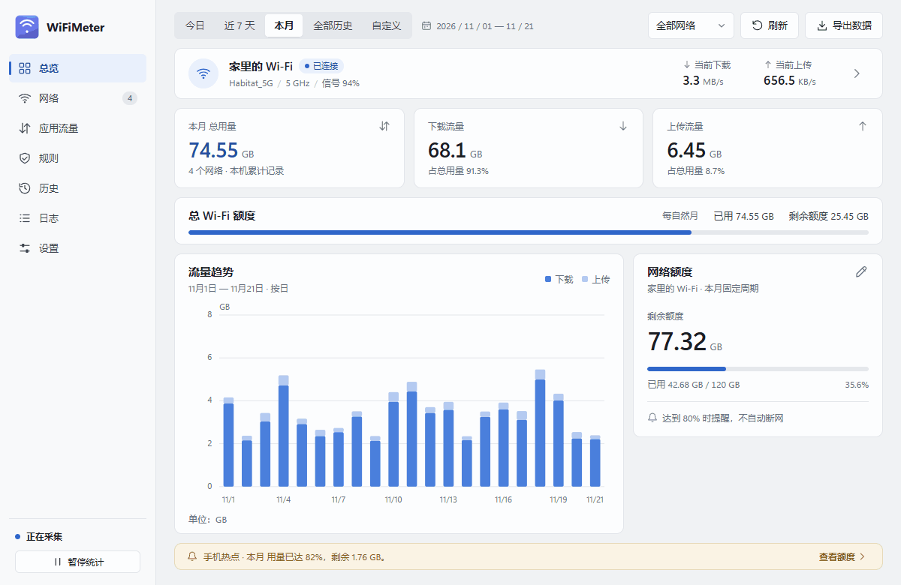

<p align="center">
  
</p>

<h1 align="center">WiFiMeter</h1>

<p align="center">
  <strong>简体中文</strong> · <a href="README.en.md">English</a>
</p>

<p align="center">
  <a href="docs/releases/v1.3.7.md#中文"></a>
  <a href="docs/PACKAGING-MATRIX.zh-CN.md"></a>
  <a href="docs/ARCHITECTURE.zh-CN.md"></a>
  <a href="docs/ARCHITECTURE.zh-CN.md"></a>
  <a href="docs/MIGRATION.zh-CN.md"></a>
  <a href="LICENSE"></a>
</p>

<p align="center">
  <strong><a href="https://github.com/chronicle12345/WiFiMeter/releases/latest">下载 Windows 版</a></strong>
  &nbsp; · &nbsp; <a href="docs/README.md">使用文档</a>
  &nbsp; · &nbsp; <a href="CHANGELOG.md">更新记录</a>
</p>



## 能做什么

- 分别统计家里、工作室、手机热点等网络的用量，查看 Wi-Fi 和有线网络的实时网速。
- 查看应用流量排行，搜索程序，按分钟、小时、日或月查询历史，也可以自选时段。
- 给单个网络或全部 Wi-Fi 设置每日、每月或累计额度，接近上限时提醒，可选超额后断开 Wi-Fi。
- 在 Windows 悬浮窗中查看网速和最近的应用用量，支持固定位置、切换形状和贴边隐藏。
- 在 Windows 上按应用禁止联网，分别设置上传、下载限速，并集中管理已有规则。
- 导出 CSV/JSON、保存完整备份，或通过 WebDAV 自动备份并在另一台设备上恢复。

支持深浅色主题、中英文界面、托盘运行和开机启动。Windows 还可以查看代理流量的应用归属估算，估算值会单独标记。

<details>
<summary>查看总览与应用历史截图</summary>


</details>

## 安装与升级

从[版本页](https://github.com/chronicle12345/WiFiMeter/releases/latest)下载 Windows x64 安装包，按提示安装。首次启动时，按需开启应用流量采集并完成授权；悬浮窗、备份和开机启动都可以在设置中调整。缺少 WebView2 时，安装器会安装所需运行时。

Windows x64 可在应用内检查更新，下载和安装分别确认。手动升级前先正常退出 WiFiMeter。

<details>
<summary>其他平台、旧版迁移与使用说明</summary>

当前 1.3.7 提供 Windows x64 版本。Linux 和其他 Windows 架构的构建暂停，仍可查看[源码构建说明](packaging/README.zh-CN.md)和历史版本。

Electron 1.2.x 用户需要安装一次 Tauri 版本，已有 SQLite 数据继续保留；更早的 Windows 文件版可以在设置中导入旧目录。备份和旧版迁移见[数据迁移与恢复](docs/MIGRATION.zh-CN.md)。

Wi-Fi 总额度只统计 Wi-Fi，代理归属估算不改变网络总量和额度计数。下载限速在 WiFiMeter 运行期间生效；使用代理的应用需要对代理程序设置限制。

</details>

## 从源码运行

安装 Node.js、Rust、CMake、支持 C++20 的编译器及 [Tauri 平台依赖](https://v2.tauri.app/start/prerequisites/)，然后运行：

```sh
git clone https://github.com/chronicle12345/WiFiMeter.git
cd WiFiMeter
git switch dev
npm ci --prefix apps/desktop
npm run build:backend
npm start
```

桌面检查使用 `npm run test:unit` 和 `npm run test:ui`。后端及原生宿主检查见[测试指南](docs/TESTING.zh-CN.md)，参与开发前请阅读[开发流程](docs/DEVELOPMENT.zh-CN.md)。

## 文档与反馈

[文档目录](docs/README.md)包含悬浮窗、应用采集、数据恢复和开发指南。遇到问题或有功能建议，可以[提交 Issue](https://github.com/chronicle12345/WiFiMeter/issues)。

## 许可证

WiFiMeter 使用 [MIT 许可证](LICENSE)。依赖许可见[第三方说明](backend/third_party/README.zh-CN.md)和 [WinDivert 说明](apps/desktop/native/windows/WinDivert/README.zh-CN.md)。
