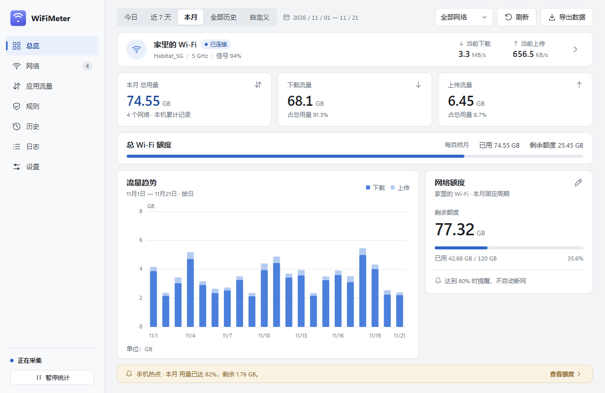
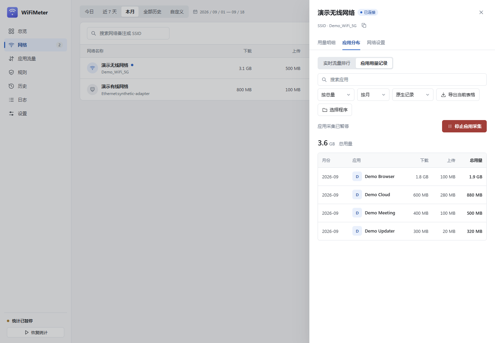

<p align="center">
  
</p>

# WiFiMeter

简体中文 | [English](README.en.md)

WiFiMeter 是一个桌面流量统计工具，用来查看网速、找出占用流量的应用，并按网络记录每天的用量。数据保存在本机。

[下载 Windows 版](https://github.com/chronicle12345/WiFiMeter/releases/latest) · [使用文档](docs/README.md) · [更新记录](CHANGELOG.md)

<a href="docs/releases/v1.3.7.md#中文"></a>


演示使用当前版本的界面，网络、应用记录和流量均为模拟数据。

## 能做什么

- 查看 Wi-Fi 和有线网络的实时网速、上传和下载用量。不同网络分别统计，也可以给网络添加备注。
- 查看应用流量排行，搜索应用，按分钟、小时、日或月回看用量，也支持自选日期和时间范围。Windows 下可查看代理流量的应用归属估算，估算值会单独标记。
- 给单个网络或所有 Wi-Fi 设置额度，按日、按月或累计计量。快用完时提醒，也可以在超额后自动断开 Wi-Fi。
- 用 Windows 悬浮窗随时查看网速和最近的应用用量，支持固定位置、切换形状和贴边隐藏。
- 在 Windows 上禁止某个应用联网，或分别限制它的上传和下载速度。已有规则可以集中查看和修改。
- 导出 CSV/JSON、保存完整备份，或通过 WebDAV 自动备份、在另一台设备上恢复数据。

支持中英文界面、托盘运行和开机启动。代理估算不改变网络总量与额度计数；Wi-Fi 总额度只统计 Wi-Fi。下载限速在 WiFiMeter 运行期间生效，使用代理的应用需要对代理程序设置限制。

<details>
<summary>查看静态截图</summary>





</details>

## 安装与升级

从[版本页](https://github.com/chronicle12345/WiFiMeter/releases/latest)下载安装包，按提示安装。当前 1.3.7 提供 Windows x64 版本；Linux 和其他 Windows 架构的构建暂停，仍可查看[源码构建说明](packaging/README.zh-CN.md)和历史版本。

首次启动时，按需开启应用流量采集并完成授权。在设置中可以打开悬浮窗、配置备份和开机启动。缺少 WebView2 时，安装器会安装所需运行时。

Windows x64 可在应用内检查更新，下载和安装会分别确认。手动升级前先正常退出 WiFiMeter。Electron 1.2.x 用户需要安装一次 Tauri 版本，已有 SQLite 数据继续保留；更早的 Windows 文件版可以在设置中导入旧目录。备份和旧版迁移见[数据迁移与恢复](docs/MIGRATION.zh-CN.md)。

## 从源码运行

安装 Node.js、Rust、CMake、支持 C++20 的编译器及 [Tauri 平台依赖](https://v2.tauri.app/start/prerequisites/)，然后运行：

```sh
git clone https://github.com/chronicle12345/WiFiMeter.git
cd WiFiMeter
git switch dev
npm ci --prefix apps/desktop
npm run build:backend
npm start
```

桌面检查使用 `npm run test:unit` 和 `npm run test:ui`。后端及原生宿主检查见[测试指南](docs/TESTING.zh-CN.md)，参与开发前请阅读[开发流程](docs/DEVELOPMENT.zh-CN.md)。

## 文档与反馈

[文档目录](docs/README.md)包含悬浮窗、应用采集、数据恢复和开发指南。遇到问题或有功能建议，可以[提交 Issue](https://github.com/chronicle12345/WiFiMeter/issues)。

## 许可证

WiFiMeter 使用 [MIT 许可证](LICENSE)。依赖许可见[第三方说明](backend/third_party/README.zh-CN.md)和 [WinDivert 说明](apps/desktop/native/windows/WinDivert/README.zh-CN.md)。
