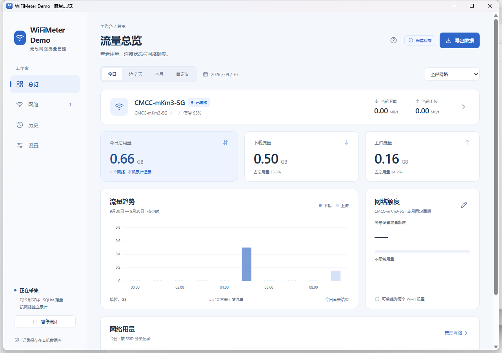
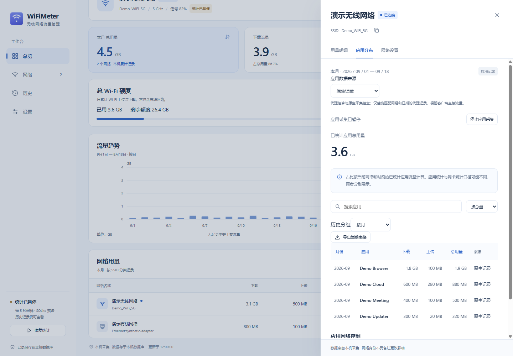

<p align="center">
  <a href="docs/assets/logo.svg"></a>
</p>

<p align="center">
  <a href="docs/releases/v1.3.6.md#中文"></a>
  <a href="docs/PACKAGING-MATRIX.zh-CN.md"></a>
  <a href="docs/ARCHITECTURE.zh-CN.md#c-后端"></a>
  <a href="LICENSE"></a>
</p>

<p align="center">
  <a href="docs/ARCHITECTURE.zh-CN.md#当前数据流"></a>
  <a href="docs/MIGRATION.zh-CN.md"></a>
  <a href="README.md"></a>
</p>

<p align="center">
  <a href="#构建与测试">构建与测试</a> &nbsp;·&nbsp;
  <a href="docs/MIGRATION.zh-CN.md">数据迁移</a> &nbsp;·&nbsp;
  <a href="docs/PACKAGING-MATRIX.zh-CN.md">平台与安装包</a> &nbsp;·&nbsp;
  <a href="https://github.com/chronicle12345/WiFiMeter/releases">版本下载</a>
</p>

<p align="center"><a href="README.md">English</a> &nbsp;|&nbsp; <strong>简体中文</strong></p>

WiFiMeter 是桌面流量统计工具，Windows 和 Linux 共用源码。Tauri 使用系统 WebView，C++ 后端采集流量，SQLite 在本机保存历史。1.3.6 提供一个 Windows x64 安装包，其他架构的构建暂停，旧安装包仍可从[版本下载](https://github.com/chronicle12345/WiFiMeter/releases)获取。

以下截图均使用虚构数据。





## 功能

- 统计 Wi-Fi 和物理有线网卡总量，显示实时上传、下载速度，支持网络备注和历史搜索。有线统计排除虚拟网卡。
- 使用 Windows ETW 采集非回环应用流量，通过 TCP EStats 实测本机回环连接，或使用 Linux eBPF。权限和覆盖状态明确显示，应用总量可能与网卡总量不同。
- 单网络额度和独立的 Wi-Fi 总额度，支持每日、每月或累计周期、多档提醒及可选的 Wi-Fi 断开。有线流量不计入 Wi-Fi 额度。
- Windows 支持按应用禁止联网，以及独立的上传、下载限速。Windows x64 随附 WinDivert，下载限速在 WiFiMeter 运行期间生效；经独立代理接收的流量需限制代理程序。Linux 不提供这些控制。
- 应用工作区共用实时流量和用量记录视图。1.3.6 增加实时来源切换，可选原生采集或端口代理估算。估算份额带有标记，替换已归属的代理速率，避免重复计数；网卡实测总量和额度不变。证据不足时保留不可用状态或原生记录。历史估算与本地 TCP 实测速率分别处理。
- 本地日期与时间范围完整包含结束分钟，支持分钟、小时、日、月分组，CSV/JSON 导出、完整备份、保留期控制、中英界面、托盘和开机启动。分钟历史从升级后积累，旧数据保留原有精度。统计和查询详情见[数据合约](contracts/README.zh-CN.md)。
- Windows [悬浮窗](docs/FLOATING_WINDOW.zh-CN.md)提供实时速率、可展开应用用量、固定、保持可见和代理筛选。实时来源选择单独保存，累计用量读取真实分钟记录。仅在左右边缘自动隐藏，固定后不隐藏。

## 原有数据与升级

Windows x64 用户可在应用内升级到 1.3.6，或从[版本下载](https://github.com/chronicle12345/WiFiMeter/releases)获取 Tauri 安装包。手动升级前正常退出 WiFiMeter。Electron 1.2.x 用户先安装一次 Tauri，后续更新选择匹配的 Tauri 安装包。其他架构继续使用最近的匹配版本；Linux 检查更新后打开官方版本页，手动安装。

从 1.3.5 起，Windows 更新检查仅读取版本信息。下载和安装分别确认，校验长度及 SHA-256 后才保存设置与数据库、静默安装并重启。拒绝下载不传输安装包；暂不安装时保留已校验缓存，使用前再次验证。启动检查仅通知可用更新。

应用采集在每个后端会话开始时默认关闭。启动和迁移成功后出现询问，同意后由辅助进程请求系统授权；拒绝后网卡统计继续运行。设置中可关闭后续询问，手动控制仍可用。平台行为和限制见 [Windows 采集](docs/WINDOWS_APP_CAPTURE.zh-CN.md)与 [Linux 采集](docs/LINUX_APP_CAPTURE.zh-CN.md)。

旧 Windows 文件版目录为 `%LOCALAPPDATA%\WiFiMeter\data`，导入前先停止旧采集器。迁移保留原文件、创建恢复备份，并在事务中导入可表示的记录，避免重复导入，报告冲突和无法表示的数据。已有 SQLite 配置保留位置：Windows 包括 `%APPDATA%\WiFiMeter Demo\wifimeter.db`，Linux 沿用 Electron 用户数据目录。卸载保留数据。详见[迁移与恢复](docs/MIGRATION.zh-CN.md)，旧文件版 [v1.1.1](https://github.com/chronicle12345/WiFiMeter/releases/tag/v1.1.1) 仍可获取。

## 安装包

1.3.6 提供一个 Windows x64 NSIS 安装包，Windows x86/ARM64 和 Linux x64/ARM64 的 CI 构建暂停。便携压缩包已取消。安装包包含 Node 业务进程、C++ 采集器和许可证；Windows 在缺少 WebView2 时安装运行时，Linux 源码构建使用 WebKitGTK 4.1。macOS 和 32 位 Linux 不在发布目标中，Windows ARM64 不支持 WinDivert 下载限速。当前目标和完整性检查由 [CI 与发布矩阵](docs/PACKAGING-MATRIX.zh-CN.md)维护。

网络控制请求管理员授权。防火墙和 QoS 规则可能在退出或卸载后保留，不再需要时先在应用中移除。

## 构建与测试

从 `dev` 开始，遵循[开发流程](docs/DEVELOPMENT.zh-CN.md)。安装 Node.js、Rust、CMake、支持 C++20 的编译器及 [Tauri 平台依赖](https://v2.tauri.app/start/prerequisites/) 后运行：

```sh
npm ci --prefix apps/desktop
npm run build:backend
npm run test:unit
npm run test:ui
```

CTest、桌面、浏览器、Rust、文档和原生检查分别见[测试指南](docs/TESTING.zh-CN.md)。`npm test` 仅执行桌面单元及集成测试和浏览器测试。平台依赖与安装包命令由[打包说明](packaging/README.zh-CN.md)维护。

## 文档

英文和简体中文指南具有同等权威性。任一语言都可以先修改，再同步并审阅另一版，最后登记配对。详见[双语文档](docs/i18n/README.zh-CN.md)与[术语表](docs/i18n/terminology.md)。

- [项目架构](docs/ARCHITECTURE.zh-CN.md)与 [Linux 应用图标](docs/LINUX_APPLICATION_ICONS.zh-CN.md)。
- [Windows 安装器来源](packaging/tauri/windows/SOURCES.zh-CN.md)。
- [第三方说明](backend/third_party/README.zh-CN.md)与 [WinDivert 说明](apps/desktop/native/windows/WinDivert/README.zh-CN.md)。

## 性能与许可

C++ 后端负责采样、计数和存储，界面查询所选范围，Tauri 使用系统 WebView。比较安装包时包含随包的 Node 业务进程、采集器和驱动；测量结论仅适用于记录中的工作量和环境。

应用采用 [MIT 许可证](LICENSE)，依赖和 Linux BPF 的许可详情见[第三方说明](backend/third_party/README.zh-CN.md)。
